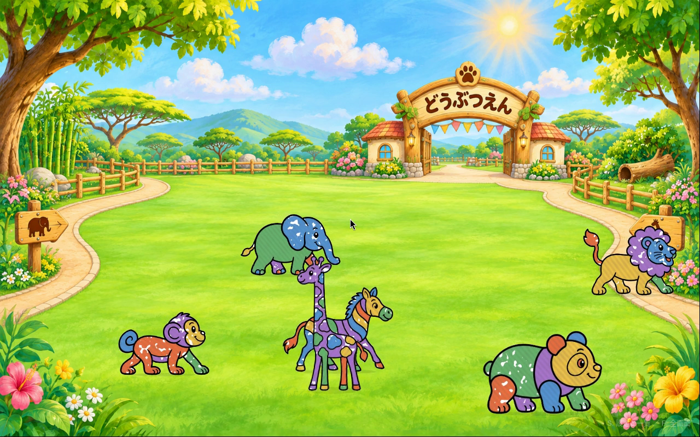

# お絵描き動物園

ぞう・ライオン・キリン・さる・パンダ・しまうまの6種。

## 印刷と会場での使い方

1. `お絵描き動物園-台紙.pdf` をA4横・等倍・片面で印刷する。
2. アプリの設定（Sキー）で「動物園」を選ぶ。
3. スキャナの保存先を取り込みフォルダに合わせる。あとは紙をスキャンするだけ。

塗った色はそのまま表示し、6種とも草原の地面を歩く。種類が分からない絵も、標準サイズで地面を歩く。既存の水族館・恐竜・ハロウィンは残る。

## 作り直すとき

- 台紙PDF: `python tools/make-zoo-sheets.py`
- 照合データ: `python tools/make-template-data.py`
- 検査: `npm test`、`npm run build`

背景・線画とも同梱し、アプリの実行時に画像を外部から取得しない。台紙の向きは照合で直し、魚用の自動回転は使わない。顔・首・鼻を固定し、足元の帯としっぽを控えめに動かす。

## 確認の範囲

- Linux上の単体テスト570件とtypecheck/build成功。
- 独立したElectronプロファイルで「動物園」ボタンの操作、白黒A4台紙6枚と色付き見本6枚の取り込み、保存後の再読込を確認済み。
- A4台紙は種類判定に加え、タイトルが残らないよう保存画像の縦横比も元の動物と比較済み。
- 色付き見本は検証用の合成データ。会場の実スキャンとWindows実機は未確認。
- 新テーマは会場への反映前の見本。

2026-11-09: 動物園の入口ゲート「どうぶつえん」、木の柵、園内の小道、動物アイコンの案内板を加えた背景へ更新。typecheck/build成功。独立したアプリで6種の表示と設定の開閉を確認し、見本動画を撮り直した。

2026-11-10: さるを四つん這いの横向きへ描き直し、巻いたしっぽをコンパクトに整理した。A4 PDFと照合形状を更新。571テストとtypecheck/build成功。新しいA4台紙と色付き見本の両方が「さる」と判定され、左向き・縦横比約1.44・題の除去・保存後の再読込を実アプリで確認。

2026-11-11: 6種すべてのしっぽを、付け根を固定したまま足踏みよりゆっくり揺らすようにした。572テストとtypecheck/build成功。実アプリで6種それぞれのしっぽ描画が上下に変化することと、設定スライダーによる停止・再開を確認。16秒の見本動画を作成。台紙PDFは変更不要。
